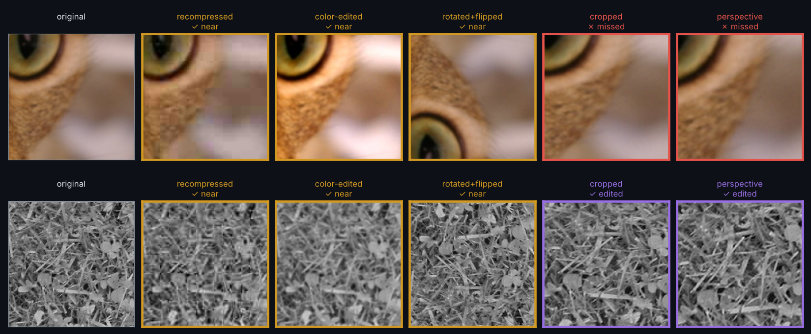
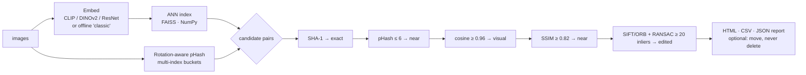
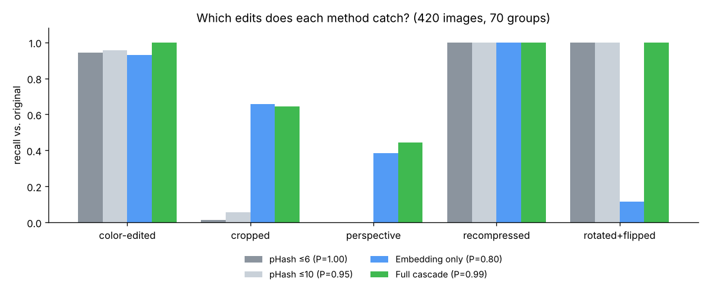

<div align="center">

# 🔍 DeepDuplicate

**Find exact, near and visual duplicate images in large collections, using a cascade of deep embeddings, perceptual hashing and geometric verification.**


<a href="https://github.com/negarsh76/DeepDuplicate/actions"></a>




<sub>Each edited copy is checked against the original. The cascade names the stage that caught it, and the misses are shown too. Results use the offline <code>classic</code> descriptor; deep backbones catch more crops and perspective changes.</sub>

</div>

---

## Why a cascade?

Each duplicate-detection technique has a blind spot:

| Technique | Strong at | Weak at |
|---|---|---|
| File hash (SHA-1) | byte-identical copies | any re-save |
| Perceptual hash (pHash) | re-compression, resizing, colour edits, **rotation and flips** (rotation-aware) | crops, perspective changes |
| Deep embeddings (CLIP / DINOv2) | crops and **semantic** near-duplicates | can confuse *similar* scenes with *the same* image |
| Keypoints + RANSAC | crops, rotation, perspective, with geometric proof | slow; needs texture |

DeepDuplicate chains them: the cheap checks run on every image, and the expensive ones run only on the few candidates that are left.



## ✨ Features

- **Two modes.** *Within* finds every duplicate group inside one folder. *Against* checks which new images already exist in a reference archive, for example a new upload batch against your dataset.
- **Pluggable backbones:** `openclip-l14`, `openclip-b32`, `dinov2`, `resnet50`, or the download-free **`classic`** descriptor. `auto` picks the best one that loads.
- **Scales up.** FAISS search (flat, switching to HNSW above 50k images) plus **multi-index hashing**, so the pHash stage never compares every pair.
- **Explainable.** Every match records *why* it was accepted: cosine, pHash distance, SSIM, inlier count.
- **Safe.** Nothing is deleted. `--move-to` moves duplicates to a quarantine folder, keeps the largest file in each group, never overwrites, and supports `--dry-run`.
- **Reports:** a self-contained HTML gallery with side-by-side thumbnails, plus CSV and JSON.
- **CLI, Python API and a small Tkinter GUI** (`deepdup-gui`). Handles EXIF orientation, truncated files and HEIC (optional).

## 🚀 Quick start

```bash
git clone https://github.com/negarsh76/DeepDuplicate.git && cd DeepDuplicate
pip install -e ".[deep]"          # or plain `pip install -e .` for the offline 'classic' mode

deepdup ~/Pictures/trip                              # duplicate groups inside one folder
deepdup new_batch/ --against dataset/ --backbone dinov2
deepdup ~/Pictures --move-to ~/Pictures/_duplicates --dry-run
```

```python
from deepduplicate import DuplicateFinder
from deepduplicate.pipeline import Config, group_matches

finder = DuplicateFinder(Config(backbone="openclip-b32"))
matches = finder.find_within("photos/")
for m in matches[:3]:
    print(m.kind, m.query, "≈", m.match, m.evidence)
print(group_matches(matches))
```

## 📊 Benchmark

The benchmark is reproducible: `python benchmark/make_benchmark.py && python benchmark/run_benchmark.py`.

It has **420 images in 70 groups**. Each group is a public-domain scikit-image sample crop plus 5 edited copies. Crops from the same source image are **hard negatives**: same texture and colours, but not duplicates. That gives 1,050 true pairs against 86,940 non-duplicate pairs.

<p align="center"></p>

| Method (offline `classic` descriptor) | Precision | Recall (all pairs) | F1 |
|---|:-:|:-:|:-:|
| pHash only (≤ 6) | **1.00** | 0.40 | 0.57 |
| Embedding only (best threshold) | 0.80 | 0.45 | 0.58 |
| **Full cascade** | 0.99 | **0.60** | **0.75** |

The cascade keeps pHash's near-perfect precision and adds the crops and perspective edits that only keypoint verification can confirm. *All-pairs* recall also counts edit-vs-edit pairs, such as a cropped copy against a rotated one, so it is stricter than the per-edit recall in the chart. To compare backbones, run `run_benchmark.py --backbone dinov2` or `--backbone openclip-l14`.

## 🗂️ Project layout

```
deepduplicate/
├── embed.py      backbones (OpenCLIP, DINOv2, ResNet-50, classic) + batching
├── index.py      FAISS / NumPy nearest-neighbour search
├── hashing.py    rotation- and flip-aware pHash
├── verify.py     SSIM + SIFT/ORB RANSAC homography
├── pipeline.py   candidate generation, the cascade, union-find grouping
├── report.py     HTML gallery + CSV
├── cli.py        `deepdup` command
└── gui.py        `deepdup-gui` desktop app
benchmark/        synthetic benchmark builder + evaluation
tests/            pytest suite
```

## 📄 License

MIT

---

<p align="center">Made by <a href="https://github.com/negarsh76">Negar Shojaei</a> · AI researcher in computer vision</p>
